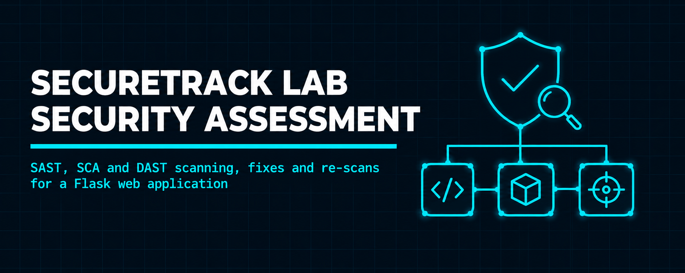
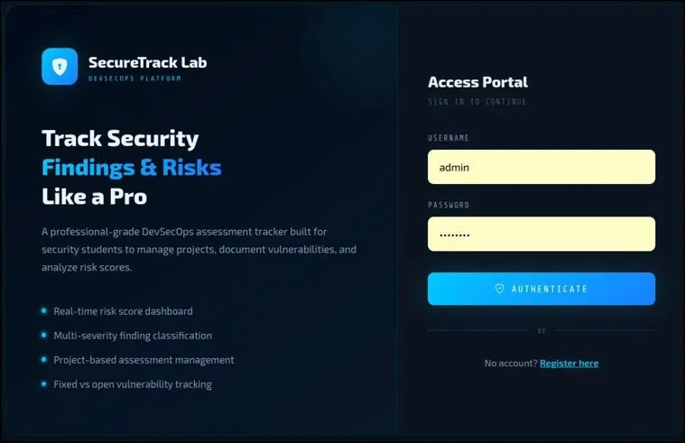
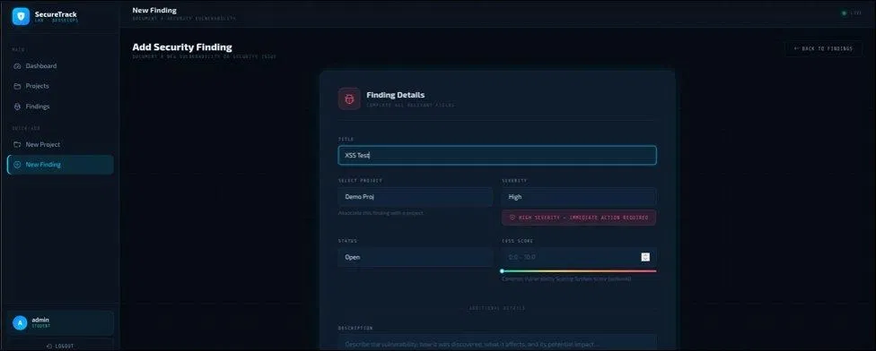
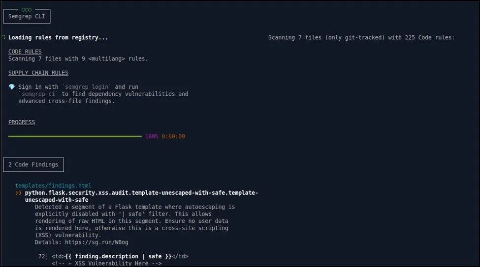
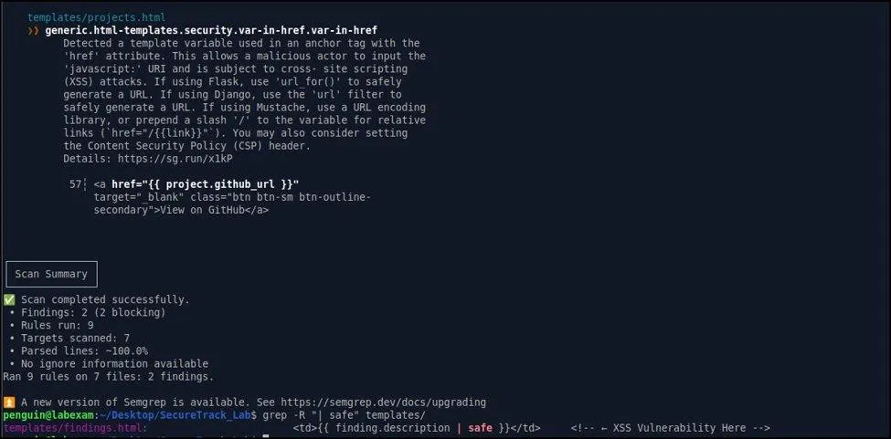
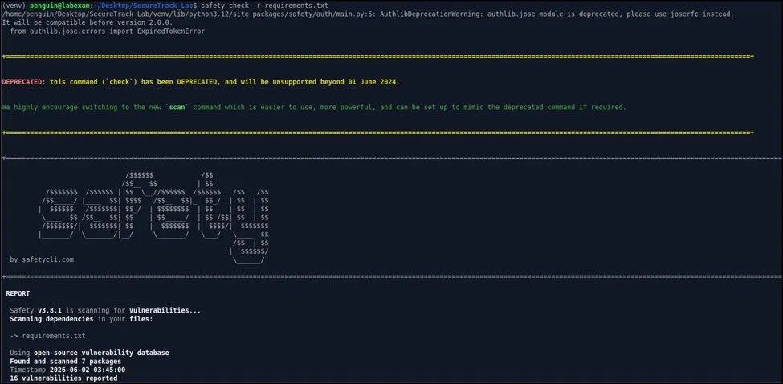
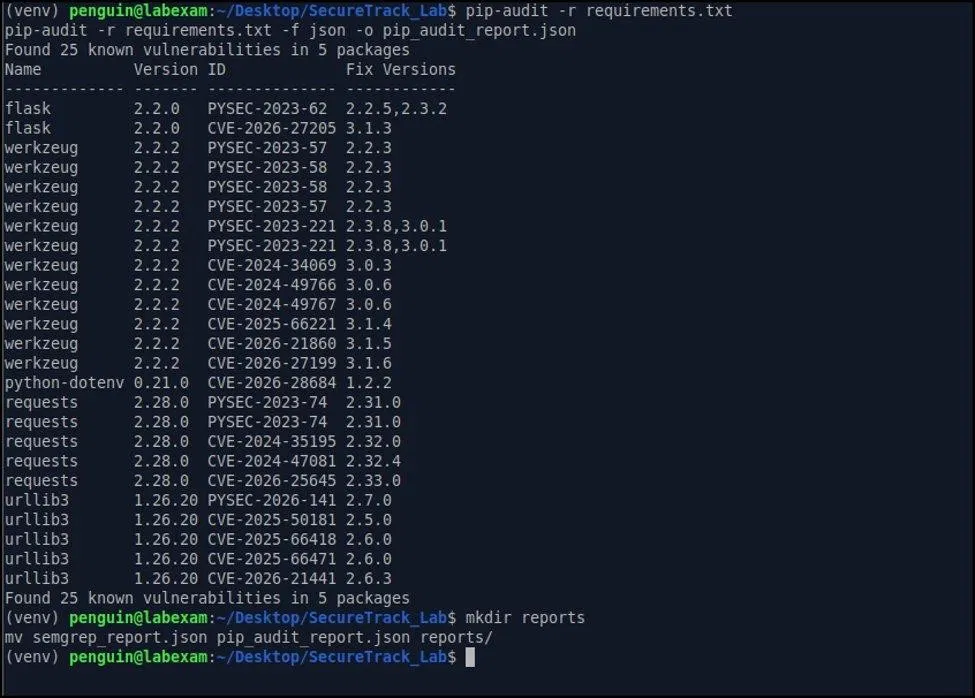
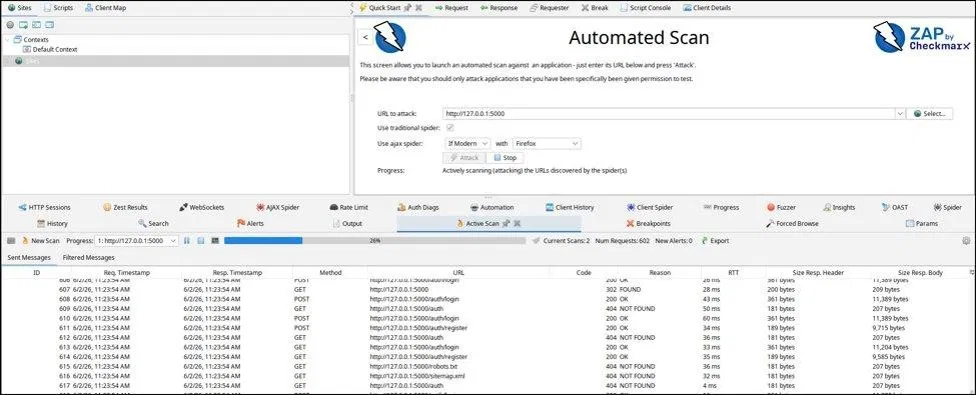
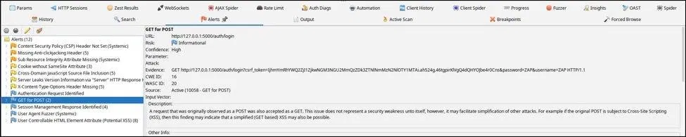
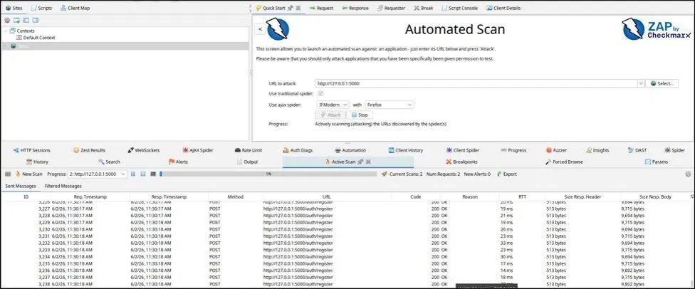

<p align="center">
  
</p>

<h1 align="center">SecureTrack Lab Security Assessment</h1>

<h3 align="center">SAST, SCA and DAST scanning, fixes and re-scans for a Flask DevSecOps web application</h3>

<p align="center">
  
  
  
  
  
</p>

<p align="center">
  <a href="#overview"><b>Overview</b></a> ·
  <a href="#tools-and-commands"><b>Tools</b></a> ·
  <a href="#results-summary"><b>Results</b></a> ·
  <a href="#screenshots"><b>Screenshots</b></a> ·
  <a href="#fixes"><b>Fixes</b></a> ·
  <a href="#known-limitations"><b>Limitations</b></a> ·
  <a href="#repository-structure"><b>Structure</b></a>
</p>

---

## Overview

This repository documents a security scanning and mitigation project for the Secure Software Design and Development course. The target is SecureTrack Lab, a Flask web application that tracks security assessment projects and findings. The work follows a scan, fix and re-scan cycle: static analysis of the code, dependency scanning, dynamic scanning of the running app, then fixes and a second round of scans.

The application was taken from a local development repository. This repository publishes the assessment only: the report, the results and the evidence screenshots.

| | |
| --- | --- |
| **Course** | Secure Software Design and Development |
| **Application** | SecureTrack Lab, a DevSecOps assessment tracker |
| **Stack** | Python, Flask, Flask-SQLAlchemy, Flask-Login, Flask-WTF, Werkzeug, Jinja2 |
| **Database** | SQLite through the SQLAlchemy ORM |
| **Target URL** | `http://127.0.0.1:5000` (local only) |
| **Approach** | Scan, fix, re-scan |
| **Report** | [Full report (PDF)](./docs/SecureTrack-Lab-Report.pdf) |

## Tools and Commands

| Category | Tool | Version | Purpose |
| -------- | ---- | ------- | ------- |
| SAST | Bandit | 1.7.x | Python static analysis for insecure functions and hardcoded secrets |
| SAST | Semgrep | Latest | Pattern-based code scanning for XSS and template issues |
| SCA | Safety | 3.8.1 | Dependency scan against an open-source vulnerability database |
| SCA | pip-audit | Latest | Known CVEs in `requirements.txt` |
| DAST | OWASP ZAP | 2.17.0 | Spidering and active scanning of the running app |

| Tool | Command |
| ---- | ------- |
| Bandit | `bandit -r . -o bandit_report.json --format json` |
| Semgrep | `semgrep scan --config auto .` |
| Safety | `safety check -r requirements.txt` |
| pip-audit | `pip-audit -r requirements.txt -f json -o pip_audit_report.json` |
| OWASP ZAP | Automated Scan from the ZAP GUI against `http://127.0.0.1:5000` |

## Results Summary

| Area | Before | After | Note |
| ---- | ------ | ----- | ---- |
| XSS in `findings.html` | Exploitable, alert popup confirmed | Fixed | `\| safe` filter removed |
| pip-audit | 25 vulnerabilities in 5 packages | 9 in 4 packages | 64% fewer |
| Safety | 16 vulnerabilities in 4 packages | 9 in 4 packages | 44% fewer |
| Security headers | Flagged as missing by ZAP | 6 headers added | Added with a Flask `after_request` hook |
| Semgrep | 2 blocking findings | 1 documented | `var-in-href` left as a known limitation |
| ZAP | 12 alerts in the initial scan | 16 alerts in the re-scan | Re-scan includes new CSP notes and 2 SQL injection alerts, see limitations |

### Initial findings

| Tool | Finding |
| ---- | ------- |
| Semgrep | `template-unescaped-with-safe` in `findings.html` line 72: `\| safe` disables autoescaping |
| Semgrep | `var-in-href` in `projects.html` line 57: a template variable in an `href` allows `javascript:` URIs |
| pip-audit | Flask 2.2.0 (2), Werkzeug 2.2.2 (12), python-dotenv 0.21.0 (1), requests 2.28.0 (5), urllib3 1.26.20 (5) |
| ZAP | Missing CSP, anti-clickjacking and `X-Content-Type-Options` headers, cookie without `SameSite`, server version leak, Subresource Integrity missing, GET accepted for the login POST |

## Screenshots

### Application

| | |
| --- | --- |
|  |  |
| <sub>SecureTrack Lab login page (Access Portal)</sub> | <sub>Add Finding form used for the XSS test</sub> |

### SAST: Semgrep

| | |
| --- | --- |
|  |  |
| <sub>Finding 1: `\| safe` filter in `findings.html`</sub> | <sub>Finding 2: `var-in-href` in `projects.html`, with scan summary</sub> |

### SCA: Safety and pip-audit

| | |
| --- | --- |
|  |  |
| <sub>Safety 3.8.1: 16 vulnerabilities reported</sub> | <sub>pip-audit: 25 known vulnerabilities in 5 packages</sub> |

### DAST: OWASP ZAP

| | | |
| --- | --- | --- |
|  |  |  |
| <sub>Active scan against the running app, 602 requests</sub> | <sub>Alerts panel from the initial scan</sub> | <sub>Re-scan after the security headers fix</sub> |

## Fixes

### Fix 1: XSS in the findings template

Semgrep flagged the `| safe` filter on user-supplied text, and a manual test confirmed that a script in the finding description ran in the browser. Removing the filter keeps Jinja2 autoescaping on, and the same input is now shown as plain text.

```html
<!-- Before -->
{{ finding.description | safe }}

<!-- After -->
{{ finding.description }}
```

### Fix 2: Dependency upgrades

| Package | Before | After |
| ------- | ------ | ----- |
| Flask | 2.2.0 | 3.0.3 |
| Flask-SQLAlchemy | 2.5.1 | 3.1.1 |
| Flask-Login | 0.6.2 | 0.6.3 |
| Flask-WTF | 1.0.1 | 1.2.1 |
| Werkzeug | 2.2.2 | 3.0.3 |
| python-dotenv | 0.21.0 | 1.0.1 |
| requests | 2.28.0 | 2.32.3 |

After the upgrade, pip-audit fell from 25 to 9 vulnerabilities and Safety from 16 to 9.

### Fix 3: Security headers

ZAP flagged missing security headers. A Flask `after_request` hook now adds them to every response.

```python
@app.after_request
def add_security_headers(response):
    response.headers['Content-Security-Policy'] = (
        "default-src 'self'; script-src 'self'; "
        "style-src 'self' 'unsafe-inline'; img-src 'self' data:;"
    )
    response.headers['X-Content-Type-Options'] = 'nosniff'
    response.headers['X-Frame-Options'] = 'DENY'
    response.headers['X-XSS-Protection'] = '1; mode=block'
    response.headers['Referrer-Policy'] = 'strict-origin-when-cross-origin'
    response.headers['Strict-Transport-Security'] = 'max-age=31536000; includeSubDomains'
    return response
```

After all fixes, registration, login, project creation and finding creation were re-tested and still worked.

## Known Limitations

| Item | Status |
| ---- | ------ |
| Remaining dependency CVEs | 9 remain in the pip-audit re-scan (Flask, Werkzeug, python-dotenv and requests). The report documents that the newer versions were not tested with the current Flask-WTF setup |
| `var-in-href` in `projects.html` | The GitHub URL field should be validated server-side to accept only `http` and `https`. Flagged for future work |
| ZAP SQL injection alerts | 2 alerts appeared in the re-scan. The report's review concluded they are likely false positives because all queries go through the SQLAlchemy ORM, but they were not exploited or confirmed either way |

## Key Takeaways

- **Static analysis catches template flaws early.** Semgrep found the `| safe` XSS before any dynamic test.
- **Dependencies were the biggest source of findings.** pip-audit alone reported 25 vulnerabilities.
- **Dynamic scanning shows what static tools cannot.** ZAP flagged missing HTTP headers and the login form accepting GET.
- **Never use `| safe` on user input.** It turns off Jinja2's XSS protection.
- **Scan, fix, re-scan works.** Each round gave a measurable result to compare against.

## Repository Structure

```
securetrack-lab-security-assessment/
├── README.md
├── LICENSE
├── docs/
│   └── SecureTrack-Lab-Report.pdf
└── images/
    ├── banner.png
    ├── login-page.png
    ├── xss-test-finding.png
    ├── semgrep-xss-finding.png
    ├── semgrep-var-in-href.png
    ├── safety-scan.png
    ├── pip-audit-scan.png
    ├── zap-active-scan.png
    ├── zap-alerts.png
    └── zap-rescan.png
```

## License

**© 2026 Abdul Wahid**. Licensed under [**CC BY-NC-ND 4.0**](./LICENSE) (Attribution, NonCommercial, NoDerivatives). You may view, reference and share a link to this work with credit. Commercial use and redistributing modified copies are not permitted.

## Disclaimer

All scans were run against a local copy of the application at `127.0.0.1` for educational purposes. No third-party systems were tested. Credentials shown in the screenshots are lab-only values.

## Contact

<p align="center">
  <b>Abdul Wahid</b>
</p>

<p align="center">
  <a href="mailto:a.wahid7860668@gmail.com"></a>
  <a href="https://www.linkedin.com/in/abdul-wahid022"></a>
  <a href="https://github.com/abdul-wahid022"></a>
</p>
